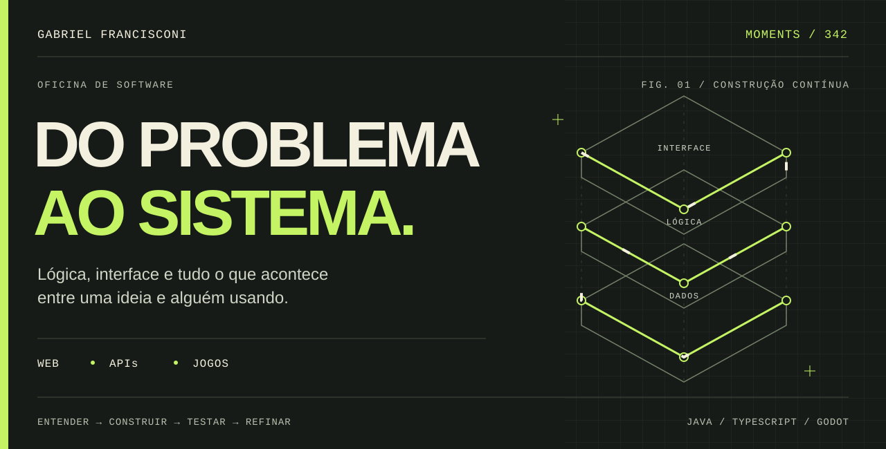
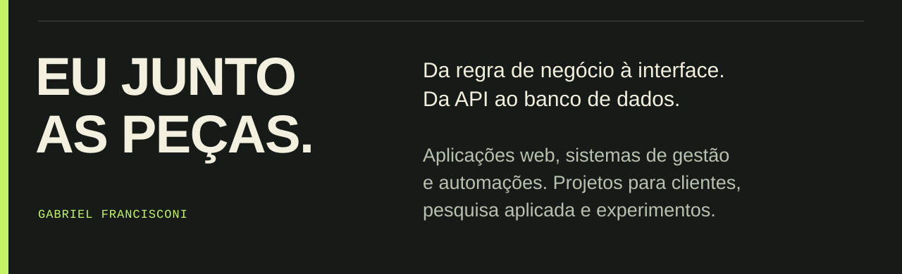
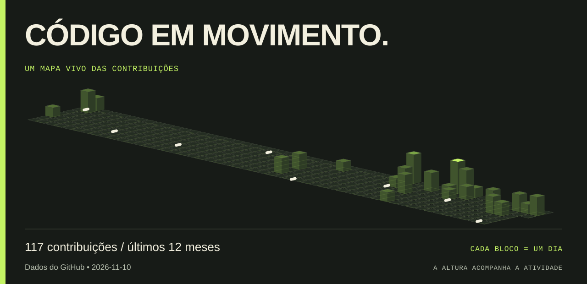
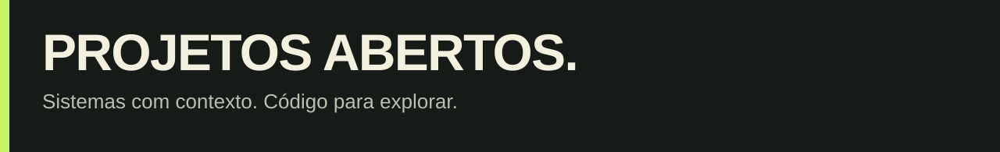
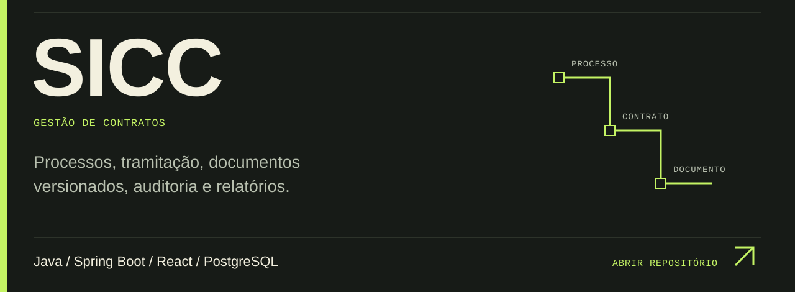
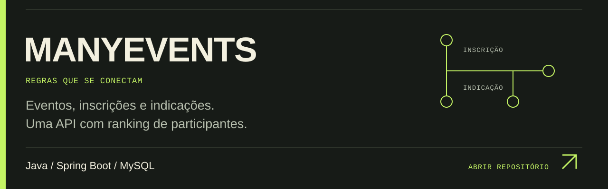
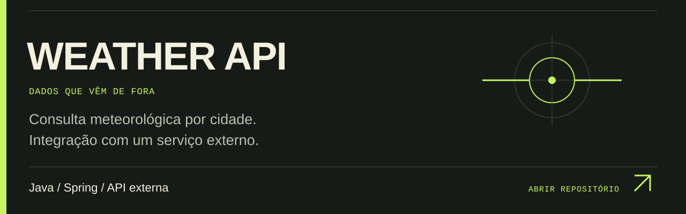
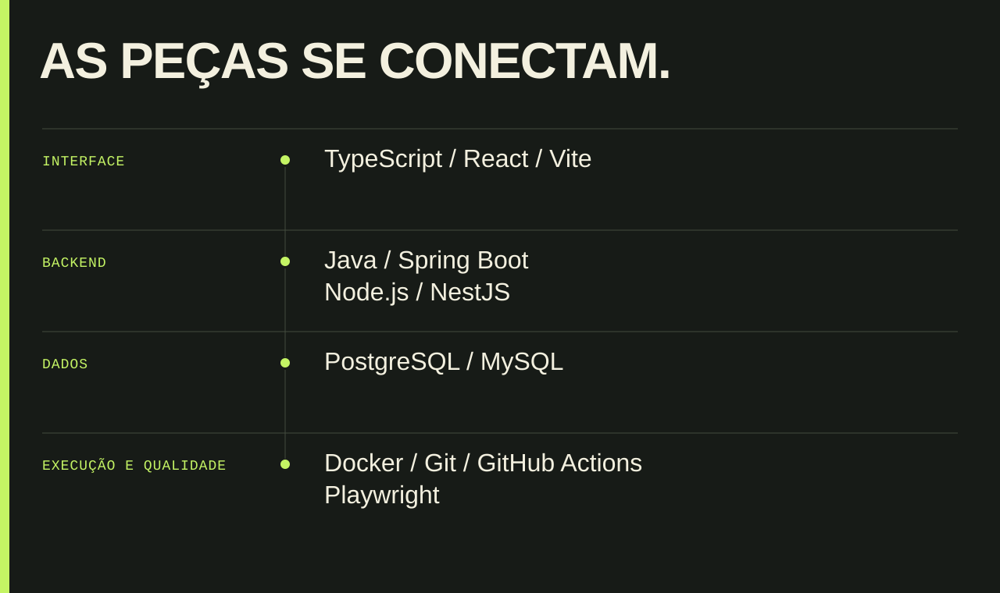
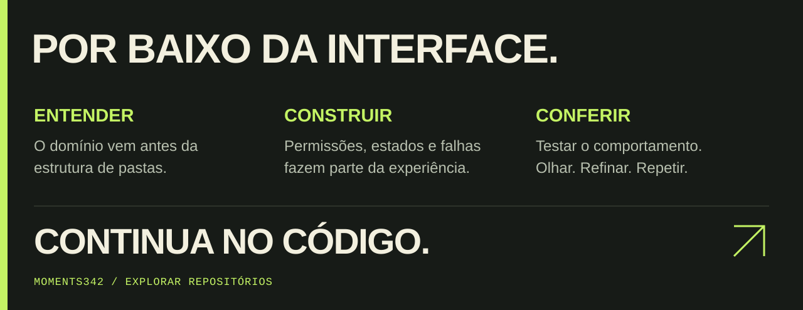

<!-- Painéis originais, responsivos e com texto alternativo. -->
<picture>
  <source media="(max-width: 600px)" srcset="./assets/workbench-mobile.svg">
  
</picture>
<picture>
  <source media="(max-width: 600px)" srcset="./assets/intro-mobile.svg">
  
</picture>
<a href="https://github.com/moments342?tab=overview">
<picture>
  <source media="(max-width: 600px)" srcset="./assets/activity-mobile.svg">
  
</picture>
</a>
<picture>
  <source media="(max-width: 600px)" srcset="./assets/projects-mobile.svg">
  
</picture>
<a href="https://github.com/moments342/SICC">
<picture>
  <source media="(max-width: 600px)" srcset="./assets/sicc-mobile.svg">
  
</picture>
</a>
<a href="https://github.com/moments342/ManyEvents_API">
<picture>
  <source media="(max-width: 600px)" srcset="./assets/manyevents-mobile.svg">
  
</picture>
</a>
<a href="https://github.com/moments342/WeatherAPI">
<picture>
  <source media="(max-width: 600px)" srcset="./assets/weather-mobile.svg">
  
</picture>
</a>
<picture>
  <source media="(max-width: 600px)" srcset="./assets/stack-mobile.svg">
  
</picture>
<a href="https://github.com/moments342?tab=repositories">
<picture>
  <source media="(max-width: 600px)" srcset="./assets/method-mobile.svg">
  
</picture>
</a>

